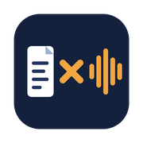
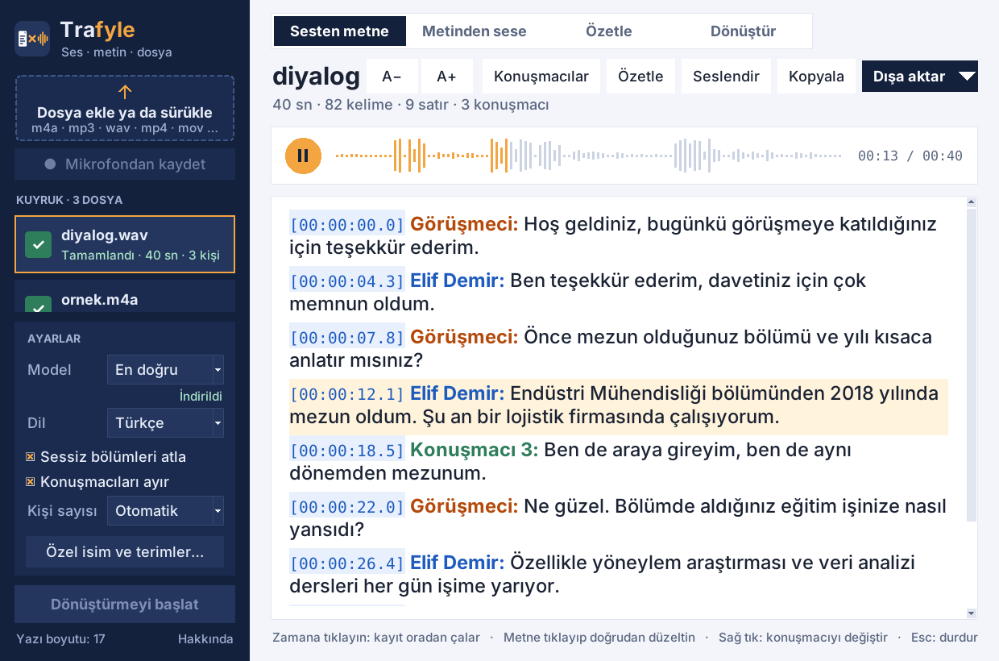

<p align="center">
  
</p>

<h1 align="center">Trafyle</h1>

<p align="center">
  <b>Ses, metin ve dosya dönüştürücü — bilgisayarınızdan çıkmadan.</b><br>
  Ücretsiz ve açık kaynaklı · Mac ve Windows · Türkçe için tasarlandı
</p>

<p align="center">
  <a href="https://github.com/aargunk/trafyle/releases/latest/download/Trafyle-Kurulum.exe"><b>⬇ Windows için indir</b></a> ·
  <a href="https://github.com/aargunk/trafyle/releases/latest/download/Trafyle-mac.zip"><b>⬇ Mac için indir</b></a> ·
  <a href="https://aargunk.github.io/trafyle/">Tanıtım sayfası</a>
</p>

<p align="center"></p>

## Neler yapar?

- **Sesten metne:** Ses ve video kayıtlarını yazıya döker ([faster-whisper](https://github.com/SYSTRAN/faster-whisper)),
  konuşmacıları ayırır. Zamana tıklayınca kayıt oradan çalar; metni yerinde düzeltirsiniz. Word, PDF, metin,
  SRT/VTT altyazı olarak kaydeder.
- **Mikrofondan kaydet:** Toplantı, ders, görüşme kaydı; bitince kendiliğinden yazıya dökülür.
- **Metinden sese:** Bilgisayarın Türkçe sesiyle okur. Sayılar, tarihler, kısaltmalar Türkçe okunuşa çevrilir;
  telaffuz sözlüğü ile ince ayar yapılır.
- **Dönüştür:** Taranmış belge ve fotoğraftan metin (OCR), PDF → metin/Word, video ya da video bağlantısından ses,
  HEIC → JPG ve görüntü küçültme.
- **Özetle (isteğe bağlı):** Kısa özet, ana noktalar, toplantı notu. Kullanıcının kendi Claude, ChatGPT ya da
  Gemini API anahtarıyla ve açık onayıyla çalışır.

**Gizlilik:** Yazıya dökme, konuşmacı ayırma, seslendirme ve dönüştürme tamamen bilgisayarda çalışır. Hesap,
reklam ve kullanım takibi yoktur. Ayrıntılar: [gizlilik notu](https://aargunk.github.io/trafyle/gizlilik.html).

## Kurulum

Hazır kurulum dosyaları [Releases](https://github.com/aargunk/trafyle/releases) sayfasındadır. Trafyle imza
sertifikası kullanmadığı için ilk açılışta bir güvenlik uyarısı çıkar:

- **Windows:** “Windows bilgisayarınızı korudu” → **Ek bilgi** → **Yine de çalıştır**.
- **Mac (Apple Silicon):** Zip'i açın, Trafyle'ı Uygulamalar'a sürükleyin ve açın. Uyarı çıkarsa
  **Sistem Ayarları › Gizlilik ve Güvenlik › Yine de Aç**.

İlk yazıya dökmede konuşma tanıma modeli bir kerelik indirilir (75 MB – 1,6 GB).

## Kaynaktan kurulum

Python 3.12 gerekir ([python.org](https://www.python.org/downloads/)). Intel Mac ve Linux için de bu yol kullanılır.

- **Mac:** `Kur.command` dosyasına çift tıklayın. Mikrofon izni için ardından `Paketle.command`'ı çalıştırın
  (uygulamayı kendi başına çalışan bir .app olarak paketler).
- **Windows:** `Kur.bat` dosyasına çift tıklayın.
- **Terminal ile:**

  ```bash
  python3.12 -m venv .venv
  source .venv/bin/activate        # Windows: .venv\Scripts\activate
  pip install -r requirements.txt
  python app.py
  ```

## Yeni sürüm yayınlama

1. `app.py` içindeki `APP_VERSION`'ı artırın ve `CHANGELOG.md`'ye not ekleyin.
2. `.github/release-notes.md` dosyasını güncelleyin, sonra etiket gönderin: `git tag v3.4.1 && git push origin v3.4.1`
   (ya da GitHub'da **Releases › Draft a new release** › etiket `v3.4.1` › **Publish**).
3. [`.github/workflows/release.yml`](.github/workflows/release.yml) Mac ve Windows kurulum dosyalarını üretip
   birkaç dakika içinde sürüme ekler. Uygulamalar yeni sürümü kendiliğinden bildirir.

## Proje yapısı

| Dosya | İçerik |
|---|---|
| `app.py` | Arayüz (Tkinter) |
| `engine.py` | Yazıya dökme, konuşmacı ayırma, model indirme |
| `recorder.py` | Mikrofondan kayıt |
| `tts.py`, `trnorm.py` | Metinden sese ve Türkçe okunuş |
| `converters.py` | OCR, PDF, video, görüntü dönüştürme, bağlantıdan ses |
| `ai.py` | Özetleme (kullanıcının kendi API anahtarıyla) |
| `exporters.py` | Word, PDF, metin, altyazı çıktıları |
| `winplat.py` | Windows'a özgü metin tanıma, sesler, klasörler |
| `updater.py` | Yeni sürüm denetimi |
| `Kur.command`, `Paketle.command`, `build.sh` | Mac kurulumu ve paketleme |
| `Kur.bat`, `windows/` | Windows kurulumu ve paketleme |
| `docs/` | Tanıtım sayfası (GitHub Pages) |

## Katkı

Hata bildirimi ve önerileriniz için [Issues](https://github.com/aargunk/trafyle/issues). Kod katkısı için
[CONTRIBUTING.md](CONTRIBUTING.md)'ye bakın.

## Lisans

Copyright © 2026 Argun Karacabey.
Trafyle [GNU Genel Kamu Lisansı sürüm 3](LICENSE) ile dağıtılan özgür yazılımdır ve **hiçbir garanti olmaksızın**
sunulur. Kullanılan üçüncü taraf bileşenler ve lisansları: [`assets/LISANSLAR.txt`](assets/LISANSLAR.txt).
Kullanım koşulları: [aargunk.github.io/trafyle/kosullar.html](https://aargunk.github.io/trafyle/kosullar.html).
